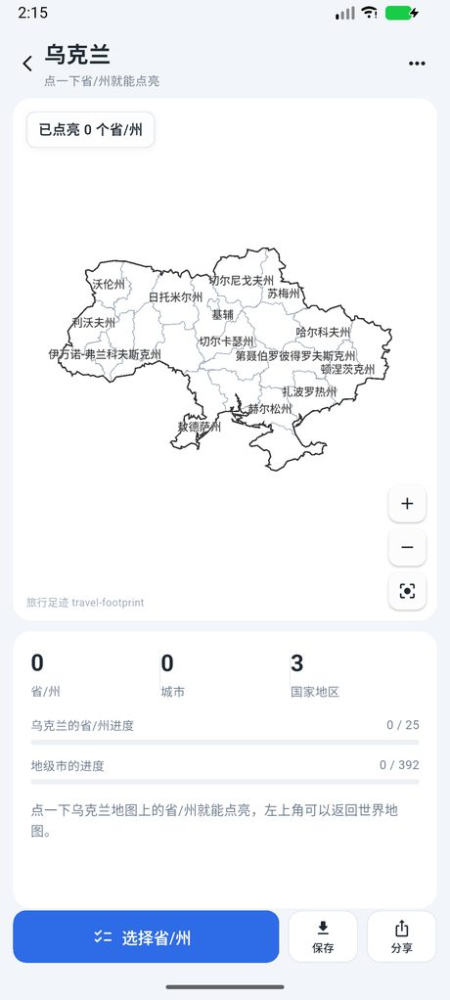

# 旅行足迹 · travel-footprint

把去过的地方在地图上点亮，随时看"我去过哪些地方"，还能把这张地图存成图片分享出去。

> 参考产品：[zuji.subsfast.com](https://zuji.subsfast.com)；本项目是独立的安卓 App（Flutter），地图数据离线内嵌，**不需要联网**。
> 版本：**0.2.0**（全新重构版） · 改动记录见 [log.md](log.md) · 旧版开发日记见 [docs/旧版开发日记.md](docs/旧版开发日记.md)

| 国内足迹 | 国家特写 | 全球足迹 | 选择面板 |
| --- | --- | --- |
|  |  |  |  |

## 功能

- **省市两级中国地图**：34 个省级行政区 + 392 个地级行政区（含台湾 21 个县市），白色底图、省界深、市界浅。
- **点一下就点亮**：点省份 = 整省点亮/取消；放大后（双指或右下角 +）点城市 = 单个城市点亮/取消。
- **全球足迹**：236 个国家和地区，同样点击点亮，标注会自动避让，不会糊成一团。
- **实时计数**：`已点亮 N 省 M 市` / `已点亮 N 个国家和地区`，概览卡里还有总体进度条。
- **选择面板**：省份三态勾选（整省全选 / 部分 / 未选）、展开逐个城市勾、`显示地名`、`仅看已选`、一键清空。
- **存图与分享**：把地图画面（含计数与水印）按 3 倍像素导出 PNG 存进相册，或直接调系统分享。
- **自动保存**：已点亮的地方存在本地，退出重进不丢。

## 使用

1. 打开 App，点地图上的省份即可点亮（再点一下取消）。
2. 双指放大或用右侧 `+` 放大，进入市级视图后可以精确点单个城市。
3. 右上角切到「全球」记录去过的国家和地区。
4. 底部「保存」写进相册（`Pictures/TravelFootprint/`），「分享」直接发出去。

## 数据说明

地图数据由 ECharts 的 UTF8Encoding 压缩 GeoJSON 解码后打包成紧凑格式（`assets/geo/cn.json`、`assets/geo/world.json`），
坐标以「经纬度 × 10000」的整数存储，运行时按等距圆柱投影绘制。构建脚本在 `tools/build_geo.mjs`，细节见 [log.md](log.md)。

## 构建

```powershell
# 需要 Flutter 3.38+ / JDK 21 / Android SDK 36
$env:JAVA_HOME='D:\applications\Android Studio\jbr'   # 换成你自己的 JDK 路径
flutter pub get
flutter build apk --release        # 产物：build/app/outputs/flutter-apk/app-release.apk
```

开发调试：`flutter run -d <device-id>`；检查：`flutter analyze`、`flutter test`。

> 0.1.0 / 0.2.0 的发布包使用 debug 签名，正式发布前需要先生成自己的 keystore。

## 目录

```
lib/          应用代码（数据解析、绘制、交互、面板、导出）
assets/geo/   离线地图数据
android/      安卓工程（相册写入与分享的原生实现）
tools/        地图数据构建脚本、截图处理脚本
docs/         截图与历史文档
```

## 版本

- **0.1.0**（2026-11-17）首次重构发布：省市两级中国地图 + 全球国家、点亮交互、计数、选择面板、存图分享、本地保存。
