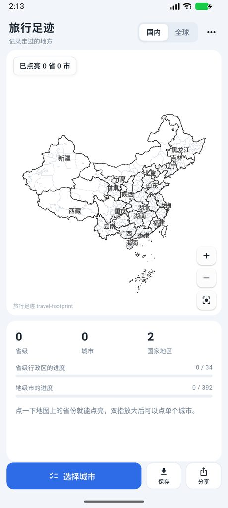
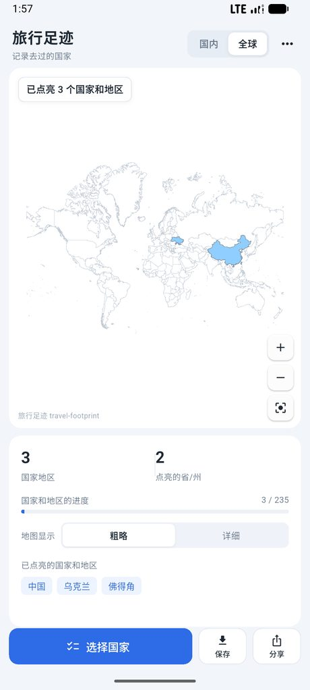
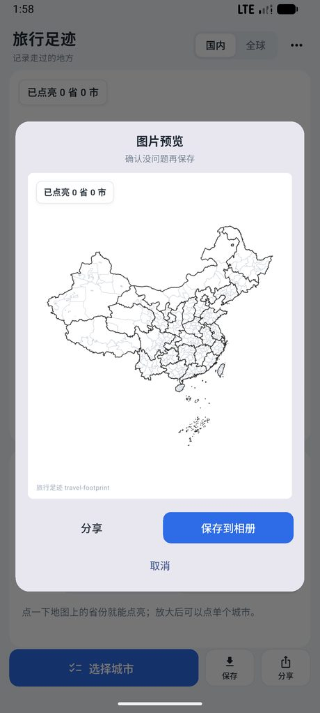

# 旅行足迹 · travel-footprint

把去过的地方在地图上点亮，随时看"我去过哪些地方"，还能把这张地图存成图片分享出去。

> 参考产品：[zuji.subsfast.com](https://zuji.subsfast.com)；本项目是独立的安卓 App（Flutter），地图数据离线内嵌，**不需要联网**。
> 版本：**0.3.3** · 改动记录见 [log.md](log.md) · 旧版开发日记见 [docs/旧版开发日记.md](docs/旧版开发日记.md)

| 国内足迹 | 全球足迹 | 国家特写 | 存图预览 |
| --- | --- | --- | --- |
|  |  |  |  |

## 功能

- **省市两级中国地图**：34 个省级行政区 + 393 个地级行政区（含台湾 22 个县市），白色底图、省界深、市界浅，
  南海诸岛完整保留，放大后可以拖到最南边看全。
- **点哪个就亮哪个**：地图上点到哪个市就只点亮那个市（会弹一句「已点亮「黄冈」」提示）；被大块包住的飞地（例如蒙古的乌兰巴托）不会跟着一起亮。
  选择面板里省份的勾选框仍可"一键全选该省所有市"，那是批量操作。
- **全球足迹（精确到省/州）**：236 个国家和地区，其中 228 个有省/州数据（共 4,234 个一级行政区）。南极洲这种没有真正省州划分的，特写里用「整块（整个区域）」选项。
  世界地图上先点一下国家**高亮选中**（顶部会出现「再点一下进入 XX」的提示），再点一下进入它的省/州地图；
  没有省州数据的小国一点即切换。
- **去过就算点亮**：只要某国里有任意一个省/州被点亮，世界地图上这个国家就是整块标准蓝，不再是浅蓝。
- **粗略 / 详细**：概览卡里的开关。粗略 = 去过就整省/整国点亮；详细 = 只亮真正去过的城市 / 省州。
- **实时计数**：国内 `已点亮 N 省 M 市`，全球 `已点亮 N 个国家和地区`，国家特写 `已点亮 N 个省/州`；
  概览卡里还有进度条与已点亮地名标签。
- **选择面板**：省份三态勾选、展开逐个城市勾、`仅看已选`、一键清空；全球列表里带 `>` 的国家可以直接进入特写。
- **存图先预览**：点「保存」先弹图片预览（含计数与水印），确认后按 3 倍像素存进相册，或直接调系统分享。
- **自动保存**：已点亮的地方（省/市/国家/省州）分开存在本地，退出重进不丢；粗略/详细开关也会记住。

## 使用

1. 打开 App，点地图上的省份点亮它（再点一下取消）；放大后用 `+` 或双指放大，进入市级视图可以点单个城市。
2. 右上角切到「全球」，点一下国家先选中、再点一下进入它的省/州；左上角箭头返回世界地图。
3. 概览卡的「地图显示」可以切粗略/详细，决定地图上整省整国亮还是只亮具体去过的地块。
4. 底部「保存」先看预览再存相册（`Pictures/TravelFootprint/`），「分享」直接发出去。

## 数据说明

- 中国：ECharts 的 UTF8Encoding 压缩 GeoJSON 解码后打包成紧凑格式（`assets/geo/cn.json`，34 省 + 393 市）。
- 世界：`assets/geo/world.json`（235 国）+ `assets/geo/admin1.json`（239 国、4,283 个一级行政区，来自 Natural Earth 10m）。
- 坐标以「经纬度 × 10000」的整数存储，运行时按 **Web 墨卡托**投影绘制。
- 构建脚本：`tools/build_geo.mjs`（国内 + 世界）、`tools/build_admin1.mjs`（省/州）、`tools/build_taiwan.mjs`
  （台湾县市，并入 `cn.json`）；细节见 [log.md](log.md)。

## 构建

```powershell
# 需要 Flutter 3.38+ / JDK 21 / Android SDK 36
$env:JAVA_HOME='D:\applications\Android Studio\jbr'   # 换成你自己的 JDK 路径
flutter pub get
flutter build apk --release        # 产物：build/app/outputs/flutter-apk/app-release.apk
```

开发调试：`flutter run -d <device-id>`；检查：`flutter analyze`、`flutter test`。

> 目前发布包使用 debug 签名，正式发布前需要先生成自己的 keystore。

## 目录

```
lib/          应用代码（数据解析、绘制、交互、面板、导出）
assets/geo/   离线地图数据
android/      安卓工程（相册写入与分享的原生实现）
tools/        地图数据构建脚本、截图处理脚本
docs/         截图与历史文档
```

## 版本

- **0.3.3**（2026-11-24）台湾省界改为 22 个县市并集（精度与市界一致）、系统导航栏自动下隐、全球「详细」模式精确到市、返回键改为先退一步再双击退出、省界去重叠（泰国等）、小岛不再丢失
- **0.3.2**（2026-11-23）南极洲只保留一行整块选项、国内地图彻底不受粗略/详细影响（点哪个市只亮哪个市）、中国有足迹时世界地图粗略与详细都能正确显示。
- **0.3.1**（2026-11-23）南极洲恢复并用「整块」选项记录、国内点击只点亮单个城市、被包住的飞地（乌兰巴托）不再跟着点亮。
- **0.3.0**（2026-11-23）按 11 条反馈修复：省与市不再连带点亮、去过任一省州即整国点亮、世界地图两次点击进入特写、
  南海可拖到全貌、台湾 22 县市真实边界、移除南极洲、"粗略/详细"开关、命中判定优化（小岛小块也能点）、
  存图先预览、移除地图上所有地名、全球页面不再显示国内城市数。
- **0.2.0**（2026-11-17）墨卡托投影修正形状、隐藏城市名、国家省州特写、台湾 21 个县市。
- **0.1.0**（2026-11-17）首次重构发布：省市两级中国地图 + 全球国家、点亮交互、计数、选择面板、存图分享、本地保存。
